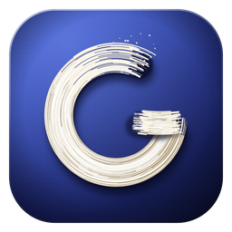

# Gesso

A fast, GPU-accelerated design canvas in Rust.

Gesso is an early prototype. Expect rough edges, and keep backups of anything you care about.

## Try it

Windows builds are on the [releases page](https://github.com/iSynic/Gesso/releases). Unzip and
run `gesso.exe`. Nothing needs installing.

## Build from source

You need a recent stable Rust toolchain.

```bash
cargo run --release -p desktop
```

The executable is `target/release/gesso`. `cargo test --workspace` runs the tests. Tests that
need a GPU run with `GPU_TESTS=1`.

## What's here

- `apps/desktop`: the app, built on winit, wgpu, Vello and egui.
- `apps/cli`: `canvas`, for rendering, exporting, validating and scripting documents.
- `apps/mcp`: `canvas-mcp`, which connects AI agents to the open document.
- `crates`: the engine: document model, layout, rendering, editor, scripting.
- `docs`: the architecture, the file format and the stage reports.

## License

Licensed under either of the [Apache License, Version 2.0](LICENSE-APACHE) or the
[MIT license](LICENSE-MIT), at your option. Third-party assets are listed in [NOTICE](NOTICE)
and dependencies in [docs/licenses.md](docs/licenses.md).
