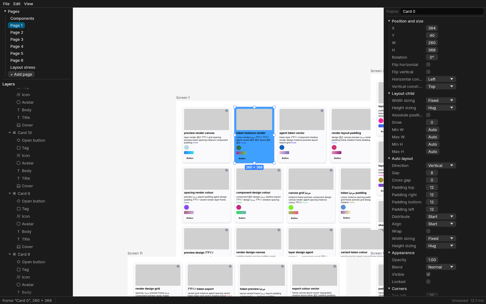
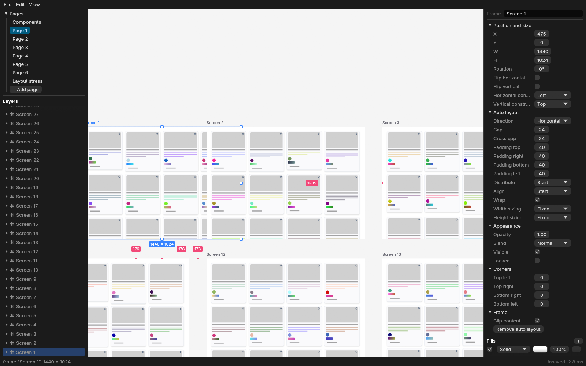

# Stage 5 report: the canvas app (2026-10-29)

Deliverable 5 from the brief: the canvas app with selection, transforms and the layers and
properties panels.

**Machine:** the same as before. Windows 11, Intel Core i5-11600KF (6C/12T), 32 GB,
**NVIDIA GeForce RTX 3080 (Vulkan, driver 610.88)**, release build, Rust 1.98.

**How latency was measured:**
- The app's latency numbers come from scripted sessions (`desktop --script`). They replay input
  through the editor's controller, the same code real pointer events reach.
- Each frame is timed from applying the input to the GPU finishing, with vsync off, in a
  1920×1080 window. The panels take part of the window, so the canvas is about 1340×1030.

**Raw results** are in `results/stage5/`:
- `desktop-latency-run{1,2,3}.json` and `desktop-open50mb-run{1,2,3}.json`, with every frame
  recorded;
- `run{1,2,3}.json` and `.log` for the full `bench` suite, gated against Stage 4.

Ranges are min–max across three runs in separate processes.

## What was built

| Path | What it holds |
|---|---|
| `crates/editor` (≈3.7k lines, new) | UI-free editor core. `Session`: store, layout deriver, scene, index, camera per page, selection and scope, layers model, dirty state, save and open. Also hit-testing and selection rules, tools as state machines, transform gestures, snapping and smart guides, auto-layout reorder and reparenting, commands and shortcuts, a clipboard payload, the property specs that generate the panel, and the autosave journal |
| `crates/editor/tests` (≈1.1k lines) | Selection, transforms, tools, clipboard, autosave and recovery; property tests for gestures with undo-all and for the layers model |
| `apps/desktop` (≈2.6k lines, new) | winit + wgpu + egui shell. Vello canvas in an egui image, screen-space overlays, menus and toolbar, the layers panel (virtualised tree, pages, drag to reorder or reparent, rename, visibility and lock), the properties panel (generated sections, fills, strokes, effects, auto layout), files and recent files, recovery prompt, scripted-session mode |
| `apps/desktop/sessions/*.json`, `apps/desktop/tests/script.rs` | Latency and screenshot scripts. Two GPU-gated tests: edits followed by undo-all, and kill-and-recover |
| `crates/bench` (changed) | `editor` scenario (100k nodes on one page); `bench docs` writes the benchmark documents as `.canvas` bundles |
| `crates/text` (changed) | Han fallback across locales (a bug the screenshots showed, see Deviations); `INTER_TTF` exposed for the UI |
| `xtask` | Layers now `doc` < `text` < `layout` < `index` < `format` < `render` < `render-cpu` < `render-vello` < `editor` < `bench`, `desktop`, `xtask` |
| `docs/` | `architecture.md` v5 (§2, §7, §10 rewritten, §11, §13), `licenses.md` regenerated, this report, two screenshots |
| `.github/workflows/ci.yml` | Editor tests with 5,000 property-test cases; `editor` joins the bench gate. Still inactive |

### How a frame is drawn

1. winit events reach egui.
2. Canvas input goes to the editor's `Controller` inside the egui frame. Gestures apply
   coalesced transactions, and the layout deriver, scene, index and layers update.
3. `Session::frame` collects the visible fragments for the current zoom band. Re-encoding gets a
   4 ms budget, after which the previous band is drawn.
4. Vello renders into an offscreen texture.
5. egui draws the panels, the canvas image and the overlays to the surface in one pass.

Overlays are painted in screen space from the editor's `Feedback`.

## Benchmarks

### Against the brief

p95 in ms, vsync off. The brief's limit is 16 ms (60 fps); our internal gate is 8 ms.

**Run 1 was slower across the board.** It ran right after a build, probably with the GPU still
in a low clock state. Runs 2 and 3 agree, so the table gives all three runs and then runs 2–3
alone.

| Scenario | p95, 3 runs | p95, runs 2–3 | p50, runs 2–3 | Brief | Gate |
|---|---|---|---|---|---|
| Drag a screen (193 nodes) at 100 %, 100k-node doc, snapping on | 5.2–9.4 | **5.2–5.4** | 3.8–3.9 | ✓ | ✓ |
| Resize a screen (auto-layout relayout of its cards) | 5.3–13.6 | **5.3–6.3** | 4.5–5.0 | ✓ | ✓ |
| Reorder drag of a card in the 10k auto-layout tree (indicator only) | 6.0–7.1 | **6.0–6.1** | 4.9–5.1 | ✓ | ✓ |
| … the drop (reorder commits, layout's structural path) | 56–76 | 56–58 | | ✗ one frame | ✗ |
| Resize a card inside the 10k tree (live relayout) | 8.2–9.3 | **8.2–9.0** | 6.9–7.1 | ✓ | ✗ |
| Properties panel: number edits (width) | 6.5–14.2 | **6.5–7.5** | 5.8–6.0 | ✓ | ✓ |
| Properties panel: colour edits (fill) | 4.7–13.3 | **4.7–5.4** | 4.3–4.5 | ✓ | ✓ |
| Drag a screen at 100 % in the 50 MB doc | 6.9–8.6 | 6.9–8.6 | 5.8–6.7 | ✓ | ✗ (1 of 3 runs over) |
| Zoom sweep 3 % → 200 % → 3 %, with the 4 ms encode budget | 15.2–26.1 | **15.2–15.3** | 9.7–10.8 | ✓ p95; worst frame 32–46 | ✗ |
| Idle at fit view (19.3k-node page, all 100 screens) | 12.2–12.8 | | 9.5–9.8 | ✓ | ✗ |
| Layers panel with the whole 19.3k-node page expanded, at fit view | 13.7–14.9 | | | ✓ | egui part ✓ (below) |

**Where the time goes** (p50 per frame, ms, from the per-frame breakdown):

| Frame | Editor + egui UI | Our scene work | Vello CPU (encode, upload, submit) |
|---|---|---|---|
| Drag a screen at 100 % | 0.8–1.5 (both) | 0.01–0.04 | 1.5–2.4 |
| Number edit in the panel | 0.9–1.9 | 1.5–3.1 (re-encode the edited screen) | 1.8–3.0 |
| Reorder drag, 10k tree | 0.7 | 0.02 | 2.8–3.3 |
| Fit view, 100 screens | 0.4–1.1 | 0.02–0.03 | 7.3–9.1 |
| Zoom sweep | 1.3–1.8 | 0.02–0.03 | 6.5–8.2 |

- **The editor itself is cheap.** The UI frame, our display-list work and the editor's
  gesture work stay at or under about 2 ms everywhere, as do hit-testing and snapping (below).
- **The misses are Vello's own CPU time**, as in Stage 4:
  - packing and uploading large scenes when the whole page is in view (8–10 ms);
  - resolving glyphs every frame at the zoom where text stops being greeked. The worst
    zoom-sweep frames take 15–20 ms there.
- **The other zoom-sweep spike** is the first visit to a zoom band. One 2,000-node fragment
  takes about 29 ms to encode, mostly shaping its text. The budget is checked between
  fragments, not inside one.

### Editor CPU work (`bench` `editor` scenario)

The scenario puts 100k nodes on one page: all six generated pages are merged into 519 screens
holding 99,992 nodes.

| | p95, 3 runs | Brief | Gate |
|---|---|---|---|
| Hit-test a click, exact, with scope climbing | 0.006–0.007 | < 1 ✓ | ≤ 0.2 ✓ |
| Hit-test deep (Ctrl) | 0.004–0.006 | < 1 ✓ | ≤ 0.2 ✓ |
| Marquee over the whole page (selects 519 screens) / inside one screen | 0.14–0.16 / 0.03–0.04 | | measured |
| Snap candidates for a gesture / snap per frame | 0.014–0.030 / 0.002 | | ≤ 1 ✓ |
| Move frame for a 193-node screen (snap, coalesced tx, scene and index updates) | 0.19–0.22 | | ≤ 4 ✓ |
| Autosave batch on the main thread after a 120-frame drag (230 ops → 2) | 0.03–0.04 | | ≤ 8 ✓ |
| Autosave batch after deleting a screen and undoing it | 0.03–0.05 | | ≤ 8 ✓ |
| Layers rows, everything expanded (99,991 rows) / collapsed (519) | 13.8–15.3 / 0.06–0.07 | | measured |
| *The snapshot route the journal replaced:* `to_data` at 100k nodes / 50 MB | 67–75 / 40–68 | | ✗ (why the journal) |

**Startup and memory:**

| | Result |
|---|---|
| 50 MB document (64.5k nodes): process start → first frame | 1.53–1.64 s, of which opening (parse, layout deriver, scene) 0.87–0.95 s |
| 100k-node document (110k nodes, 89 MB): process start → first frame | 2.1–3.0 s, of which opening 1.46–2.04 s |
| RSS with the 50 MB document open, after editing | 363–370 MB (brief < 1 GB ✓) |
| RSS with the 100k-node document, after the latency session | 358–359 MB |
| Autosave: base snapshot when a journal starts on an untitled or recovered session (once) | 38–40 ms |

### Against Stage 4

The `bench` suite ran with `--baseline` set to the three Stage 4 runs: the slowest p95 per
metric, flagging anything more than 10 % and more than 0.05 ms slower. It flagged 42, 35 and 20
metrics in runs 1, 2 and 3.

**Most of it is machine noise.** Code Stage 5 didn't touch is flagged in every run: 50 MB
parse +11–70 %, `build_and_validate` +18–74 %, `copy_5_artboards` +22–43 %. The machine was
busier than during Stage 4 (Firefox, NVIDIA Broadcast and the audio service were all using CPU,
about 60 % load while the bench ran).

**One change does cost something: the Han fallback fix.** I ran an A/B test back to back, with
the same build and the fix switched off by an environment variable. Edits that re-shape text
containing Chinese characters, which now find a real face instead of drawing boxes, cost more:

| Metric (p95) | With the fix | Without |
|---|---|---|
| `resize_leaf_in_10k_tree` | 0.90 ms | 0.36 ms |
| `keystroke_in_10k_tree` | 0.77 ms | 0.57 ms |
| `undo_root_resize` | 11.0 ms | 8.2 ms |

Shaping 10k labels is unchanged (63 vs 68 ms parallel). I kept the fix: correct glyphs matter
more than half a millisecond.

**Nothing in the renderer changed**, and its numbers are inside the range of runs on a noisy
machine.

## Tests

**125 tests pass** (81 in Stage 4). Clippy is clean with `-D warnings`, `cargo xtask layers`
passes, and `cargo deny check licenses` reports "licenses ok".

New in Stage 5:

- **Selection (9):**
  - hit order with overlap and rotation;
  - clipping ancestors;
  - strokes and unfilled shapes;
  - locked and hidden nodes;
  - scope climbing, double-click drilling, Esc;
  - marquee in scope.
- **Transforms (14):**
  - move under rotated and flipped parents;
  - resize with aspect lock and from the centre, and flipping past the far edge;
  - multi-select scale and rotate;
  - snapping (nearest candidate, threshold, equal spacing);
  - reorder index in row, column and wrap layouts;
  - reparenting keeps the world position;
  - groups scale their children.

  Also a property test: random gestures, then undo-all, restore the document JSON exactly.
- **Tools and commands (14):**
  - drawing by drag and by click, with Shift and Alt;
  - commands and shortcuts;
  - copy and paste, in place and centred;
  - nudge in auto layout;
  - a press inside a selected frame drags the frame, while a click selects the child;
  - autosave: quiet time, a batch with undo, redo and delete replayed exactly, a journal on a
    bundle that survives a torn last line, staleness after a save, compaction.
- **Layers (property test):** after random expands, reveals, renames, deletes, duplicates,
  moves and undos, the model equals a fresh rebuild.
- **The app, GPU-gated (`GPU_TESTS=1`, 2 tests, run locally):**
  - a scripted session (drag, resize, reorder, panel edits, duplicate, group, delete), then
    undo-all: the saved `document.json` is byte-identical to the one saved before;
  - a session with autosave on, **killed** after its edits: the recovery journal replays to
    exactly the document the session saved.
- **Property tests at 5,000 cases**, run once: gestures with undo-all and layers versus rebuild
  both pass.

## Deviations and known limits

1. **Autosave is an op journal, not a snapshot.**
   - The plan said: snapshot with `to_data` on the main thread, or switch to a journal if that
     took more than 8 ms.
   - It took 40–75 ms, so I built the journal, which is the plan's own fallback.
   - Each autosave now costs the main thread only the batch (0.03–0.05 ms). Recovery is the
     bundle, or a base snapshot, plus a replay.
   - The base snapshot (38–40 ms, once) is only taken when a journal starts on an untitled or
     recovered document.
   - Every session gets its own journal key, so a new session never overwrites an earlier
     crash's journal. Journals whose bundle was saved after they started can't be replayed, so
     they are deleted when found.
2. **Zoom sweep is still over the gate.**
   - p95 is about 15 ms (Stage 4: 12–15). The worst frames are 32–46 ms: a first-visit
     fragment encode (~29 ms), and Vello's glyph resolve at the zoom where text appears
     (15–20 ms).
   - The 4 ms budget does spread band changes over frames (9–12 frames with stale fragments
     per sweep), but it can't split one fragment.
   - Ideas for later, renderer work:
     - smaller fragments, or shaping text off the main thread before a band is needed;
     - greeking text below a higher size while the camera is moving (glyph-to-path was tried
       and rejected in Stage 4).
3. **Whole-page views cost 12–15 ms per frame**, almost all of it Vello's CPU (Stage 4 measured
   the same: pan at 5 % was 9.9–11.3 ms). The layers panel's own cost is 1.0–2.2 ms p95 of
   egui time with 19.3k rows expanded. The 13.7–14.9 ms in the table is that frame drawn at fit
   view.
4. **The reorder drop is one 56–76 ms frame.** Committing a move in the 10k auto-layout tree
   takes the layout's structural path: `edit/insert_card_in_10k_tree` and `delete_card` measure
   35–48 ms, unchanged since Stage 3. Scene and index updates follow. The drag itself stays at
   6 ms because it only shows the indicator. Fixing the drop means an incremental move in the
   layout mirror (Stage 3 code).
5. **Resizing a card inside the 10k tree is 8.2–9.3 ms**, over the gate but under the brief.
   It is live relayout (0.8 ms of scene work) plus Vello for a text-dense view at 100 %.
6. **The layers list rebuilds whole**, lazily, when the tree's shape or a name changes. That
   costs 14–15 ms with all 100k rows expanded, but 0.06 ms in the usual collapsed state. The
   plan said "incrementally from each ChangeSet"; a full rebuild of the visible rows turned out
   simpler and is cheap in practice. The property test checks it against a fresh build.
7. **Group resize uses unrotated child boxes** for the group's bounds (the layout deriver's
   `fit_group`). Rotated children inside a resized group can drift slightly: 0.25 % in the
   test, which allows for it.
8. **Scripted input skips the OS and egui event routing.** Latency starts when the controller
   gets the input, so window-message delivery and egui's widget hit-testing aren't included.
   Panel edits in the script call the same `inspect::write` the panel widgets call, rather than
   clicking widgets.
9. **The "100k" document's largest page has 19.3k nodes** (six pages plus the layout stress
   page). The app sessions use it as is; the `editor` bench merges it into one 100k-node page.
10. **Fonts:**
    - egui 0.37 ships no font data by default (the separate crate isn't in the offline cache),
      so the UI uses the bundled Inter, with Segoe UI, Segoe UI Symbol and Yu Gothic as
      Windows fallbacks. Other platforms get Inter only until fallbacks are added there.
    - The screenshots also showed simplified-Chinese characters as boxes on the canvas. Han
      text with no locale fell back to the platform's Japanese face (Yu Gothic), which lacks
      them. `text` now also appends the zh-Hans, zh-Hant, ja and ko faces; cost above.
11. **`dirs` was dropped.** It pulls in `option-ext`, which is MPL-2.0 only. `deny.toml` would
    have allowed it, but the rule is permissive dependencies, so `editor::dirs` resolves the two
    folders it needs.
12. **Not verified: IME in panel text fields.** Scripts can't drive an input method. Typing
    Latin text works; a CJK input method should be tried by hand.
13. **Carried over from Stage 4:** that report corrected an earlier draft about criterion (it
    has been a dev-dependency of `doc` since Stage 2; no download was needed).

**Out of scope, as planned** (Stage 7 or later):
- on-canvas text editing and IME;
- the pen tool;
- component instances and overrides;
- the variables panel;
- SVG and PNG on the clipboard;
- export UI, docking, rulers, minimap;
- the web build.

## Next

Stage 6: the headless CLI and the MCP server, over the same `editor` session. MCP's
`get_state` (selection, viewport) and the command registry can reuse `Session`, `commands`
and `inspect`. I'll wait for your go-ahead before starting it.
