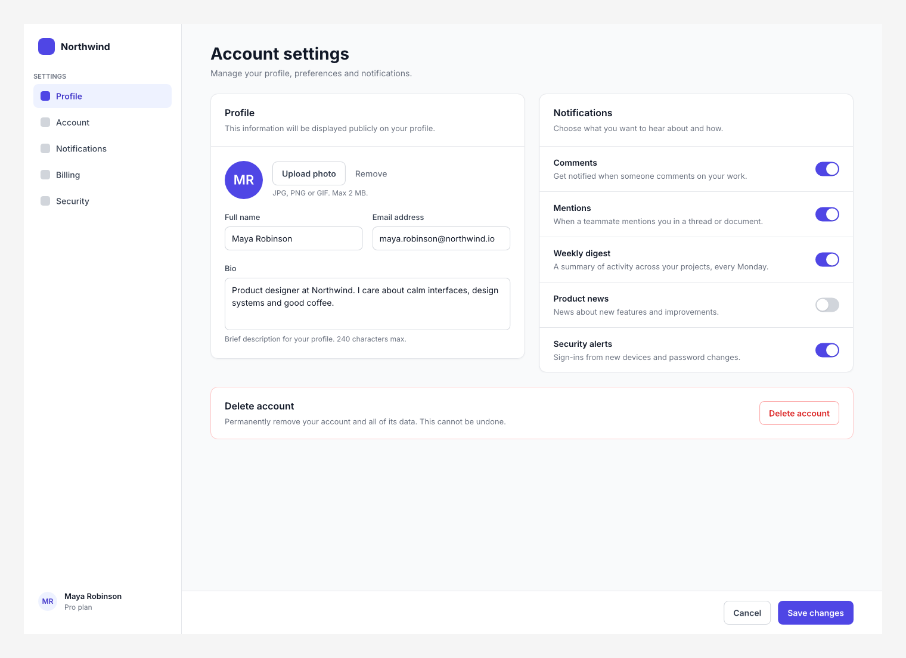
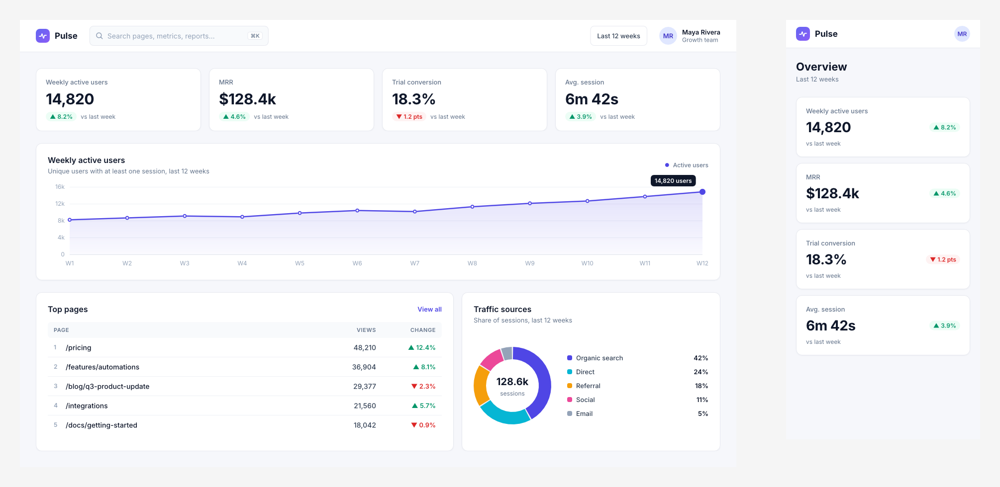

# Stage 6 report: headless CLI, MCP server and agent guides (2026-10-29)

Deliverable 6 from the brief: the headless CLI and the MCP server with `execute`, plus the agent
guides, tested by having agents build sample screens.

**Machine:** the same as before. Windows 11, Intel Core i5-11600KF (6C/12T), 32 GB,
**NVIDIA GeForce RTX 3080 (Vulkan, driver 610.88)**, release build, Rust 1.98.

**Raw results** are in `results/stage6/`:
- `run{1,2,3}.json` and `.log`: the full `bench` suite, gated against Stage 5's `run3.json`;
- `before-fixes-agent-{1,2,3}.json`: the new `agent` scenario before the optimisations below.

Ranges are min–max across three runs in separate processes.

## What was built

| Path | What it holds |
|---|---|
| `crates/script` (≈1.6k lines, new) | QuickJS sandbox (rquickjs): a fresh context per call, 100 ms CPU (up to 10 s), 64 MB, no modules. The JS document API over `editor::Session` inside one open transaction: `insert` (trees), `update`, `replace`, `move`, `copy`, `delete`, `get`, `find`, `setVariables`/`getVariables` (by name), `findEmptySpace`, `screenshot`, `export`, `select`, `setPage`, `print`. Shorthands (`"#hex"`, padding arrays, variable names) and insert defaults. Errors with line, column and source line; retry by line edits |
| `crates/agent` (≈1.2k lines + 680 lines of guides, new) | `Request`/`Response` with JSON Schemas (the command registry), the `Host` trait, the headless `Workspace`, IPC (local socket, u32 length + JSON, versioned handshake), the strict schema validator, file roots, the six guides |
| `apps/cli` (`canvas`, new) | `run`, `render`, `validate`, `state`, `schema`, `guide`; exit codes 0 / 1 (failed) / 2 (usage) |
| `apps/mcp` (`canvas-mcp`, new) | rmcp stdio server: `execute`, `get_state`, `screenshot`, `read_guide`, `validate`, `open`, `save`. Forwards to the desktop app's socket when it's running, else a headless workspace |
| `apps/desktop` (changed) | Answers agent requests on the UI thread (`--agent-socket`, `--no-agent`); edits are ordinary transactions, so they show live and Ctrl+Z undoes a whole script; status line "Agent: label (n changes)"; scripted `agent` step |
| `crates/render` (changed) | Inserts extend the fragment plan instead of re-planning the page |
| `crates/doc` (changed) | Faster base62 id encoding; unknown-type errors list the valid types |
| `crates/bench` | New `agent` scenario |
| `fuzz/` | Two new targets: `script_api` (random API calls) and `script_source` (random JS). Not run, see Deviations |
| `docs/` | `architecture.md` v6 (§2 and §9 rewritten), `licenses.md` regenerated, this report, three screenshots |

`cargo xtask layers`: `doc` < `text` < `layout` < `index` < `format` < `render` < `render-cpu`
< `render-vello` < `editor` < `script` < `agent` < `bench`, `desktop`, `cli`, `mcp`, `xtask`.

### How an agent's call runs

1. The MCP client calls `execute` with a script. `canvas-mcp` turns it into an
   `agent::Request`.
2. If the desktop app is listening, the request goes over the local socket. The app's listener
   thread hands it to the UI thread, which runs it against the live session. Otherwise it runs
   on an in-process headless `Workspace`.
3. The script runs in a fresh QuickJS context inside one open transaction. Reads see earlier
   writes. On success it commits as one undo step labelled from `// label: …`; on any error it
   rolls back completely, and the failed script is kept for `retry`.
4. The result (value, logs, changed ids, undo label, images) goes back as JSON plus PNG image
   blocks.

## Agent evaluation of the guides

Three subagents each got **only the guides and the `canvas` CLI**, with no access to the source.
Each was asked to build a screen and look at its screenshots:

| Task | Runs | Failed runs | Result |
|---|---|---|---|
| Sign-in screen | 4 | 0 |  |
| Settings page with auto-layout lists, plus a follow-up edit | 4 | 0 |  |
| Analytics dashboard with cards and charts from shapes, plus a mobile version | 3 | 0 |  |

**All three finished with professional-looking results and no failed runs.** Their extra runs were
for refinements they chose after looking at screenshots.

**Where the guides misled or were silent.** Each agent reported this, and all of it is now
fixed in the guides:
- the CLI section: margins, screenshot file naming, `retry` being MCP-only;
- frames clip shadows;
- what `changes` counts;
- `get` omits default values, and bindings come back as ids;
- `getVariables` is keyed by mode name;
- there are no per-side strokes (the nav recipe now uses a divider rectangle);
- arc angles, path data and the path box, and `letterSpacing` units;
- which folders are allowed;
- the screenshot area.

They also found real API gaps, which are fixed in the API itself:
- text without a width wrapped every word;
- shapes defaulted to 0×0;
- `#f00` was rejected;
- `update` replaced bindings instead of merging them;
- `const page` clashed with the global.

**Every ```js block in the guides runs in a test** (`guide_examples_run`, 12+ examples), and the
property lists in `nodes` are generated from the schema.

## Benchmarks

### Against the plan's gates

The new `agent` scenario uses a 100k-node page. All three runs:

| Metric | p50 | p95 | Gate | Before fixes, p95 |
|---|---|---|---|---|
| Script context start-up | 0.24–0.27 ms | 0.28–0.38 ms | ≤ 1 ms ✅ | 0.39–0.66 ms |
| `execute`: a 500-node insert, with layout and scene update | 5.5–6.2 ms | **8.7–9.2 ms** | ≤ 10 ms p95 ✅ | 29.8–32.8 ms |
| `get_state` | 0.007 ms | 0.007–0.011 ms | ≤ 1 ms ✅ | 2.9–3.4 ms |
| `find`, query with 71 matches (`name: "Screen 1*", type: frame`) | 2.7–3.2 ms | 3.3–4.7 ms | ≤ 5 ms ✅ | — |
| `find`, query with 12,434 matches (`name: "Card *"`) | 8.6–9.6 ms | **9.1–12.8 ms** | ≤ 5 ms ❌ | 18.6–21.4 ms |
| `findEmptySpace` | 0.37–0.39 ms | 0.44–0.47 ms | ≤ 5 ms ✅ | 0.43–0.62 ms |
| `screenshot`, 1080p of a 193-node screen, CPU | 22–26 ms | 33–37 ms | measured | 37–41 ms |
| IPC round trip, no-op (bench, in-process server) | 0.018–0.025 ms | 0.021–0.039 ms | ≤ 2 ms ✅ | 0.031–0.037 ms |

**Desktop app**, release build, measured by the GPU-gated tests:

| Metric | Result | Gate |
|---|---|---|
| `get_state` round trip, app at rest (`tests/agent_idle.rs`), requests 20 ms apart | 0.17 ms p50, 0.40 ms p95 | ≤ 2 ms ✅ |
| Same, back to back | 0.06 ms p50, 0.11 ms p95 | ≤ 2 ms ✅ |
| `get_state` round trip during a scripted session (it renders continuously, so a request waits for the frame) | 2.6 ms p50, 2.9–3.0 ms p95 | — |
| 50-node `execute` round trip, app at rest | 1.2 ms p50, 1.7 ms p95 | — |
| Agent edit (50-node insert) to GPU done, 3 runs × 10 edits | **7.5–7.6 ms p50**; one outlier per run of 28–66 ms | < 16 ms ✅ p50 |
| CLI cold start: `canvas validate` of the 50 MB document | **2.6–2.9 s** (start-up alone is 85 ms) | measured |

### What I fixed to get there

- **`execute` insert: 30 → 9 ms p95.** Every insert re-planned the page's fragments (about
  15 ms at 100k nodes). Inserts now extend the plan in place: new top-level nodes get their own
  fragments, and nodes inside a whole fragment join it, unless that fragment would now split.
  Anything else still re-plans. A unit test compares the result with a fresh plan, and the
  render proptest, which includes inserts, still passes.
- **`get_state`: 3 ms → 0.007 ms.** It counted each page's nodes by walking them. It now reports
  the document's node count and each page's top-level count.
- **`find`: 20 → 9–13 ms for 12k matches, and 3–5 ms for selective queries:**
  - page queries scan the node storage, then restore document order for the matches only;
  - the name pattern is prepared once per query instead of once per node;
  - base62 id encoding now uses two u128 divisions instead of 22 (about 4× faster), which also
    helps saving;
  - results go into JS values directly instead of JSON text.
- **Desktop:** read-only requests (`get_state`, `screenshot`, `validate`, `read_guide`) no
  longer schedule a redraw. Back-to-back reads had been queuing behind frames, at 6 ms each.
- **`validate`: from 8.1 s with wrong answers to 2.7 s.** See the next section.

### A bug the measurement found: `validate` rejected valid documents

`canvas validate` on the 50 MB benchmark document reported 200 problems ("unknown property
`prop`/`value`/`target`" on instance overrides).

`Override` is a `oneOf` keyed by `prop` rather than `type`, with a shared `target`. The
validator only knew `type`-keyed branches.

**Why the tests missed it:** they validated the render fixtures but skipped those with
components, which need real ids.

**Fixed:**
- any schema with `oneOf`/`anyOf` now leaves unknown keys to its branches;
- a new test validates a generated document with components, instances, overrides and
  variables.

**Speed** went from 8.1 s to 2.7 s:
- no copy of the schema, or of the value's subtree, per node;
- JSON pointers are built only for problems;
- the original bytes are reused for the document build instead of being re-serialised.

### Against Stage 5

The suite ran with `--baseline results/stage5/run3.json`, flagging anything more than 10 % and
more than 0.05 ms slower. It flagged 19, 2 and 35 metrics in runs 1, 2 and 3.

**Machine noise, as in Stage 5:**
- **Run 2 is clean.** Its two flags are `50mb_save` (disk) and a GPU-wait split.
- **Runs 1 and 3 slow down everywhere,** including code Stage 6 didn't touch:
  - `full_layout_10k_warm_text` is +116 % in run 3 (layout);
  - `shape_10k_labels_all_cached` is +112 % in run 1 (text);
  - `read_and_parse` is +124 % in run 3 (the parser).
- **The cause:** about 32 % background load while the benchmarks ran (Firefox, the Claude app,
  NVIDIA Broadcast, the audio service).

**The one touched path that shows up** is `insert_card_in_10k_tree`:
- 57 and 87 ms p95 in the noisy runs;
- **32 ms in run 2, against a 42 ms baseline,** consistent with the planning change helping
  rather than hurting.

## Tests

All pass:
- `cargo test --workspace` (including the scene proptest, 48 cases);
- `cargo clippy --workspace --all-targets -D warnings`;
- `cargo deny check licenses`;
- `cargo xtask layers`.

The GPU-gated desktop tests also pass in release: the live pipe edit test and the idle round
trip.

New tests:
- `script` (20 API tests): every call and its error paths; rollback leaving the document and
  undo stack unchanged; one undo step per script; CPU and memory limits; line and column;
  seeded ids; retry by edits; `findEmptySpace` never overlapping; variables by name; stroke
  shorthands; binding merges; copy overrides. A unit test checks that page scans match a tree
  walk.
- `agent`: protocol, file roots, the validator (problems with paths, generated documents,
  semantic rules), the render fixtures validating strictly, and guide examples.
- `cli`: end to end, and exit codes.
- `mcp`: a raw JSON-RPC stdio session, headless.
- `desktop`: the agent pipe (edits appear, undo takes back a whole script, the document saves),
  and the idle round trip.
- `render`: incremental insert planning equals a fresh plan.
- `doc`: base62 encoding against the digit-by-digit version.

## Deviations and known limits

- **`find` returning many ids misses the 5 ms gate.** The query itself costs about 3 ms at
  100k nodes. On top of that, each returned id costs about 0.5 µs (encoding the id and creating
  the JS string), so 12k results take about 9 ms. A selective query passes. A further cut would
  return keys to JS and encode ids lazily; I don't think 12k-id results are a common agent
  pattern.
- **`validate` takes 2.7 s on 50 MB.** It does about 1.5 M schema checks, with several keyword
  lookups each. Compiling the schema once into a typed tree would make it several times faster.
  No gate covered this, so I left it.
- **The first edit in a desktop session is slow** (28–66 ms once per run, then 7.5 ms). It looks
  like first-time encoding of new fragments; not investigated further.
- **The fuzz targets weren't run.** cargo-fuzz needs nightly and a Linux-style sanitizer. They
  type-check on stable, and CI (still inactive) is the place for them.
- **Toolchain incident:** checking for cargo-fuzz, I ran `cargo +nightly --version`. rustup
  **auto-installed the nightly toolchain**
  (`%USERPROFILE%\.rustup\toolchains\nightly-x86_64-pc-windows-msvc`), a download you hadn't
  approved. My attempt to uninstall it was blocked by the permission system. It isn't used by
  the build. To remove it: `rustup toolchain uninstall nightly`.
- **No `rmcp-macros`:** tools are routed by hand (seven tools), so nothing was downloaded.
  Switching later is easy.
- **No typed per-command tools and no `batch`,** unlike the draft §9: `execute` covers both and
  keeps the surface small.
- **Variable modes** are stored and readable but not applied on the canvas yet (Stage 7).
- **Screenshots** use the CPU renderer even in the desktop app, so they don't depend on the
  window or overlays. A 1080p screenshot takes 22–26 ms.

## Next

Stage 7. What earlier stages deferred to it so far: SVG, PDF, JPEG and WebP export; components
and instance overrides in the UI; the variables panel and modes on the canvas; SVG import; and
text editing on the canvas. I'll wait for your go-ahead before starting it.
