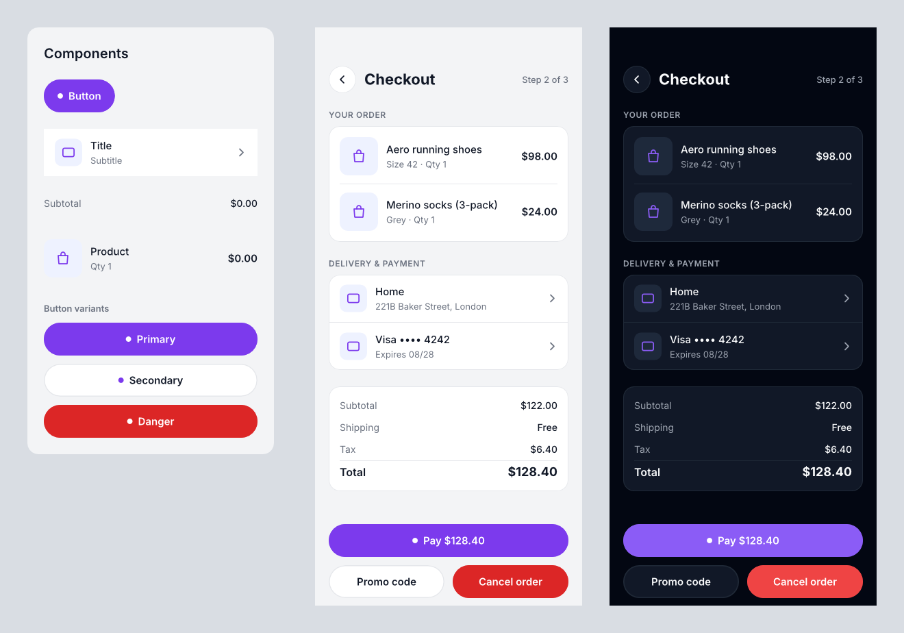

# Stage 7a report: components, instances, overrides, variables and modes (2026-10-30)

Checkpoint 7a of Stage 7 (plan: components, variables, export and the remaining v1 features).
Checkpoints 7b (export, SVG import, clipboard, images) and 7c (canvas text editing, pen tool,
accessibility) have **not** been started; this report pauses for your go-ahead.

**Machine:** the same as before. Windows 11, Intel Core i5-11600KF (6C/12T), 32 GB,
**NVIDIA GeForce RTX 3080 (Vulkan, driver 610.88)**, release build, Rust 1.98.

**Raw results** are in `results/stage7a/run{1,2,3}.json` and `.log`: the full `bench` suite
three times, gated against Stage 6's `run2.json`. Ranges are min–max across the three runs.

## Summary

- **Instances work end to end.** Instances are expanded on the fly (your choice): content,
  overrides, nested instances, constraints at the instance's size, and modes. Create, detach,
  reset overrides and go to main are available in the app, through the agent API and in the
  file format (v2, with automatic v1 migration).
- **Variables now apply.** Bindings are resolved per mode, and a mode switch takes effect on
  the canvas. Bound values are written into the file, so readers that don't evaluate variables
  still see what the app draws.
- **Gates, from your downside question (fan-out and open time):**
  - **Met:** editing a component with **100 instances** (2.9–3.8 ms p95), an override edit,
    a variable bound by 10k nodes, a mode switch, hit-testing, and opening 50 MB with
    instances (0.84–0.97 s).
  - **Missed:** editing a component with **1,000 instances, all on screen**, at
    **17–27 ms p95 against 16 ms** (p50 14.7–17.0 ms). It was 24 ms before the
    parallelisation done in this checkpoint; details below.
- **A guide-evaluation agent built a themed checkout design system with no failed runs.**
  It found one real engine bug: an override lost to a component binding. That is fixed and
  tested.

## What was built

| Path | What it holds |
|---|---|
| `crates/format` | **Format v2**: `Override.target` is an id path (`[]` = the instance), optional `modes` on page/frame/component/instance. `v1_to_v2` migration also moves an instance's own fills/strokes/radius into `[]` overrides. Schema `document.v2.schema.json`. |
| `crates/doc` | Virtual nodes (`Node.virt`), `set_expansion` (diffs content in place), `VirtualNode` op refusal, `components.rs`: `override_target`, `remap_ids` (copy/paste follows components), `set_override`, `reset_overrides`, `detach`, `create_component`. `Tx::update` on content writes an override. |
| `crates/layout` | `instances.rs` (expansion: overrides → bindings in mode context → constraints; nested paths; depth guard 16), `bindings.rs` (bound values of real nodes as ops), deriver order: bindings → expand dirty instances → settle. Expansion content is built in parallel for ≥ 16 instances. |
| `crates/render`, `crates/index` | Instances draw their content (look on the content root, layer props on the instance). Dirty fragments build in parallel (≥ 32 per frame) using read-only text/image caches after prefetch. |
| `crates/editor` | Double-click enters an instance; selection and scope map through content; commands Create component (Ctrl+Alt+K), Detach (Ctrl+Alt+B), Reset overrides, Go to main; clipboard carries the components pasted instances need; `tokens.rs` (bind/unbind, modes, variable editing). |
| `apps/desktop` | Left panel tabs **Layers / Assets / Variables**: a variables grid with modes as columns and inline editing; assets list (click to place an instance); a bind button (◇/◈) on bindable fields, bound fields show their variable; Component, Instance, "In instance" override and Modes sections; Object menu. Script steps `instance` and `enter`. |
| `crates/script`, `crates/agent` | `insert({type: "instance", component: "Button", overrides: {"Label": {text: "Buy"}, "Icon/visible": false}})`, by-name paths; `update(instance, {overrides: {...}})`; `get` with `depth` returns content with `instanceId`/`instancePath`; `update(contentId, ...)` writes overrides; `createComponent(ids, name?)`, `detach(id)`; `modes: {Theme: "Dark"}` by name. New **`components` guide**; `api`, `nodes`, `design` updated. |
| `crates/bench` | New `components` scenario (below). |
| `docs/` | `architecture.md` v7, `file-format.md` v2, `licenses.md` note, this report. |

No new crates. `layout` now uses `rayon`, which was already in the tree. `cargo deny check
licenses` and `cargo xtask layers` are clean.

### Semantics I chose (please say if you want them otherwise)

1. **An instance's fills, strokes and radius belong to its content root.**
   - They are stored as `[]` overrides, and the instance draws only its children.
   - Opacity, blend, effects, visibility and transform stay on the instance.
   - The v1 migration keeps old files looking the same.
2. **An override beats a component binding of the same property.**
   - The binding is dropped for that instance only. Overriding `bindings` rebinds instead, so a
     danger button can stay themed.
   - The evaluation agent hit the opposite behaviour as a bug.
3. **Instances don't hug.**
   - An instance has a fixed size and defaults to the component's laid-out size.
   - Content follows the component's constraints and auto layout at that size.
4. **Content can't be restructured.**
   - Inside an instance, edits become overrides. Moving, deleting or inserting into content is
     refused (`DocError::VirtualNode`).
   - Hide unwanted parts or detach.
5. **No variant sets yet** (out of scope in the plan). The `components` guide shows two ways
   to make variants: overrides on one component, or a `Button/Primary`-style family of
   components.

## Benchmarks

### The components scenario (new)

Each "→ frame" is the transaction (layout + expansion), scene update, frame build and GPU
render, waited for, at 1920×1080. "All in view" means the whole grid of instances is on
screen, the worst case.

| Metric | p50 | p95 | Gate (p95) |
|---|---|---|---|
| Component edit, 100 instances, all in view → frame | 2.2–2.6 ms | 2.9–3.8 ms | < 16 ms ✅ |
| Component edit, **1,000 instances**, all in view → frame | 14.7–17.0 ms | **17.2–27.0 ms** | < 16 ms ❌ |
| … of which transaction (expansion of 8,000 content nodes) | 4.3–5.4 ms | 5.7–8.5 ms | |
| … of which frame build (1,001 fragments, parallel) | 5.6–6.3 ms | 6.9–12.6 ms | |
| Component edit, 5,000 instances, all in view → frame | 64–67 ms | 72–84 ms | measured |
| Override edit on one instance → frame | 3.3–3.6 ms | 4.3–7.2 ms | < 16 ms ✅ |
| Colour variable bound by 10k nodes → frame | 29.9–33.2 ms | 32.3–46.5 ms | < 50 ms ✅ |
| Mode switch, 1k bound nodes → frame | 6.4–7.6 ms | 8.5–10.7 ms | < 16 ms ✅ |
| Hit-test, 110k-node page, 54k of the nodes inside 6,000 instances | 0.001 ms | 0.005–0.008 ms | < 1 ms ✅ (our gate 0.2) |
| Open 54 MB with 2,000 instances (read, parse, build, shape, expand, lay out) | 0.78–0.86 s | 0.84–0.97 s | < 2 s ✅ |
| … of which expanding instances | 89–98 ms | 93–109 ms | |
| … RSS growth after open | 95–242 MB | | < 1 GB ✅ |

**The 1,000-instance edit, and what I did about it.** The first measurement was 24 ms p95: a
4.5 ms transaction, 11 ms building 1,001 display lists on one thread, and 4–5 ms GPU.

Two changes, both general rather than special-cased:
- **Fragments build in parallel.** When 32 or more must be built in one frame, they are built
  together after text and images are prefetched. The builders only read the caches; a fragment
  that misses text is rebuilt on the main thread. Build time went from 11 ms to 4–6 ms.
- **Instance content builds in parallel.** For 16 or more dirty instances, content is computed
  in parallel; the in-place diff into the document stays sequential. The transaction went from
  4.5 ms to about 3.6 ms.

Run alone, the scenario then measured **15.7 ms p95**. In the full suite it is 17–27 ms, with
the noise described below.

What remains:
- the sequential diff, about 3 µs per instance;
- parallel build overhead: 1,000 small lists is allocation-heavy;
- about 4–5 ms of GPU encoding for 1,000 changed items.

**Options to close it:**
- **(a)** Share display lists between instances with identical content. This doesn't help
  instances with different labels, the realistic case.
- **(b)** Cache each instance's content as one GPU-side picture, re-encoding a component once
  per size. This is the larger, more general change.
- **(c)** Accept the result: 1,000 instances all on screen at once is extreme, and at 100 %
  zoom only those in view are rebuilt.

My recommendation is (c) now, and (b) if it shows up in real files.

**Fan-out cost of expanding on the fly, as promised.** Per component edit, the transaction
costs about **4.5 µs per instance shown**: 0.5 ms at 100 instances, 4–5 ms at 1,000 and
20–25 ms at 5,000. It only reports changed properties, for example 1,001 changes for a fill
edit across 1,000 instances. Opening adds about 45 µs per instance (90–110 ms for 2,000).

### Against Stage 6 (full suite)

The gate flagged 57, 52 and 54 metrics. As in Stage 6, the runs are noisy:
- **Code this checkpoint didn't change slows down too.** Cached text shaping
  (`shape_10k_labels_all_cached`) varies 0.34–1.77 ms. Stage 6's own three runs ranged
  0.35–1.74 ms, and warm layout 28–85 ms.
- **Back-to-back reruns differ by a third.** Two consecutive runs of `editframe` alone gave
  keystroke frame-plus-GPU p50 of 4.4 ms and then 2.9 ms. The GPU sat in P3 at 705 MHz
  between them.
- **The keystroke breakdown hasn't moved.** Its transaction (0.55 ms) and scene-update (1.0 ms)
  parts match Stage 6.

**Where 7a really costs something:**
- **Moving a screen.** `move_frame_screen` is consistently higher, 0.13 → 0.17 ms p50, from
  the deriver's new per-transaction checks (bindings and instances). That is far under its
  4 ms gate.
- **Open.** `read_and_parse` is 330–343 ms against Stage 6's 258–723 ms (noisy there too).
  Nodes are one field larger.

**Gates that miss in both stages:** `drag_artboard_per_frame` (8 ms gate),
`full_layout_10k_warm_text` (15 ms) and `find_query_100k` (5 ms). They missed in Stage 6 too,
and they move with the GPU-wait and machine noise above.

## Tests

- **Workspace:** `cargo test --workspace` passes, 0 failures.
- **Clippy:** `--workspace --all-targets -D warnings` is clean.
- **New property tests:**
  - **Expansion is history-independent** (`layout/tests/proptest_instances.rs`, 2,000 cases
    checked once, 256 by default).
    - The setup has a component with a bound fill, text, an auto-layout row with a bound gap
      and a nested instance. One instance is in light mode and one in dark.
    - Random edits cover component children, insert and delete, resize, overrides, variables,
      modes, and the nested component.
    - After each edit, every expansion equals a fresh load's, and a full pass from scratch
      changes no value.
    - Undoing everything restores the original expansions; redoing restores the final ones.
  - **An instance renders like its detached copy** (`render-cpu/tests/instances.rs`, 1,000
    cases checked once, 48 by default).
    - Random children (rect, ellipse, text) with random constraints, plus a nested instance,
      random overrides (root and child fills, visibility, opacity, nested paths) and a random
      instance size.
    - The pixels are identical before and after `detach`, and after undo.
- **New tests:**
  - 13 expansion tests (from earlier in 7a);
  - editor component commands, paste, and dragging inside an instance;
  - selection into instances;
  - script components, plus overrides beating bindings;
  - the v1 → v2 fixture.
- **GPU-gated desktop session** (`component_override_session_then_undo_all`). It runs in the
  real app:
  1. create a component from a card and place an instance;
  2. recolour the instance;
  3. double-click into it and recolour and fade a child;
  4. save, reset overrides, detach;
  5. undo everything.

  The mid-session file has the overrides, and the final file is byte-identical to the
  starting one.
- **Every ```js block in the guides runs** (`guide_examples_run`), now including the
  `components` guide.

**One quirk, recorded for later:** a full re-expansion can record a content property as
changed when layout then puts the same value back, for example a hug row in a dark-mode
instance. The values are correct and the test compares values; the only cost is some spurious
change entries on full passes.

## Agent evaluation

One subagent got only the `canvas` CLI and the guides. Its task was a Button component with
primary, secondary and danger variants, themed with Light/Dark variables, used on a 390-wide
Checkout screen with other reused components. It then had to make a dark copy through modes,
and in a follow-up run change the button radius and a theme colour.

- **6 runs, none failed.** The follow-up edit reached all 9 button instances and both screens.
- **Its result:** 
- **Bug it found, now fixed:** the engine bug above.
- **Guide gaps it found, now fixed:**
  - `""`-key bindings landed on the instance instead of its content root (fixed in the API).
  - Overrides come back from `get` as id paths and `kind` overrides (now documented).
  - How to change one variable value (now documented).
  - That `copy` keeps overrides (now documented).
- **What it missed, out of scope:** variant sets, an icon set, per-side strokes.

## Deviations from the plan

- **Display-list sharing between identical instances.** Not built: the plan's `Arc<Expansion>`
  sharing doesn't fit virtual nodes, and real instances differ by their overrides. Parallel
  building was used instead.
- **Override editing on canvas.** Dragging content inside an instance writes position
  overrides, as planned, and leaves the component unchanged
  (`dragging_inside_an_instance_overrides_position`). Resize goes through the same update path
  but has no test of its own. Per-field "overridden" markers in the properties panel aren't
  built; the "In instance" section lists the overridden properties, each with a Reset button.
- **Goldens.** Instance goldens beyond the existing `components_instances` fixture weren't
  added; the pixel property test covers overrides, nesting and constraint resize more broadly.
- **End-to-end checks.**
  - Covered by tests and the evaluation agent, through the same `agent::Workspace` path that
    `canvas-mcp` uses headless: a component built through the agent, opening an old v1 file
    (the migration fixture).
  - Not done by hand: building a component in the app and an agent run through `canvas-mcp`
    with the desktop app attached.

## Next

7b (export, SVG import, clipboard, images) is ready to start. Nothing has been committed.
