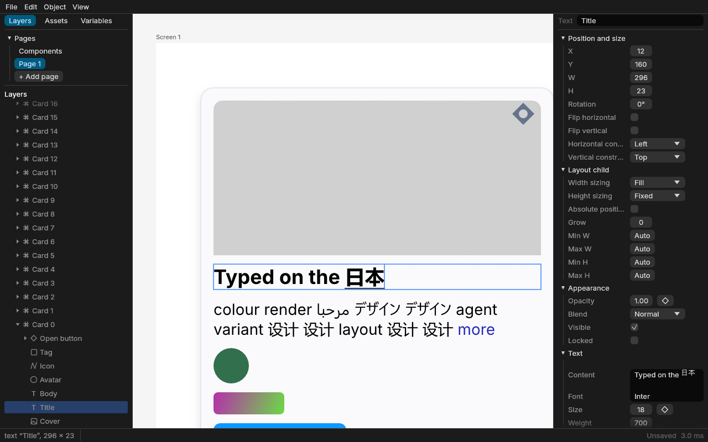

# Stage 7c report: text editing on the canvas, pen tool, accessibility (2026-10-30)

This is checkpoint 7c, the last of Stage 7. Stage 7 is now complete, and this report pauses
for your go-ahead.

**Machine:** unchanged. Windows 11, Intel Core i5-11600KF (6C/12T), 32 GB, **NVIDIA GeForce
RTX 3080 (Vulkan)**, release build, Rust 1.98.

**Raw results** are in `results/stage7c/run{1,2,3}.json` and `.log`: the full `bench` suite
run three times, gated against Stage 6's `run2.json`. Two earlier sets are kept:
- `before-index-fix/`: the first runs, which missed the typing gates;
- `before-entry-shrink/`: the runs before the last index change.

Ranges below are min–max across the three runs.

## Summary

- **Text editing on the canvas.**
  - **How to start:** double-click a text, press Enter on it, or use the Text tool.
  - **What works:** caret, selection, typing, word and line navigation, clipboard, and
    Bold/Italic/Underline on a range.
  - **Styles survive edits:** spans keep their styles, and the Text section of the properties
    panel applies to the selected characters.
  - **Undo:** one step per word.
  - **Instances:** text inside an instance is edited as an override.
- **Input methods (IME).** The composition is drawn underlined in the text and reflows it.
  Committing it is one typing step. **This was tested only with synthetic events.** I have not
  tried the Windows Japanese or Chinese input methods by hand (see "Not done").
- **Pen tool (P) and path edit mode.**
  - **Pen:** corners, smooth points with mirrored handles, Alt to break handles, click the
    first point to close, and snapping. The whole path is one undo step.
  - **Path edit:** move points and handles, add a point on a segment (curves split exactly),
    delete points, toggle smooth/corner, and nudge. One undo step per drag.
  - **File format:** unchanged; paths are still SVG `d` data.
- **Accessibility.**
  - The canvas is an AccessKit node, with the layers around the selection as children (role,
    name, bounds, selected state).
  - Tab and Shift+Tab move between siblings; Enter goes into a container or edits a text or
    path; Shift+Enter goes to the parent.
  - Panel controls that showed only a symbol, swatch or bare field now have accessible names.
  - I have not checked this with Narrator by hand.
- **All 7c gates pass in all three runs.** The first runs missed the typing gates by 3–8 ms.
  The cause was the spatial index, not the text code; I fixed the index (below).
- **One regression to look at:** opening a page now rebuilds the spatial index about 20 %
  slower, roughly +20 ms at 100k nodes. This is the cost of the index fix. Details and options
  are in "Your call".

## Benchmarks

### The canvas_edit scenario (new)

**Setup:**
- **The text:** 2,044 characters in 42 spans of mixed weight, style, size and colour, 640 px
  wide, inside the 10,102-node auto-layout tree.
- **Measurement:** each step is timed from the input event to a presented GPU frame. That
  covers editor work, layout, scene update, the caret overlay, frame build, render and the wait
  for the GPU.

| Metric (ms) | p50 | p95 | max | Gate | Before the index fix (p95) |
|---|---|---|---|---|---|
| Keystroke → frame | 6.9–7.1 | **11.9–12.4** | 15.2–16.8 | < 16 ✅ | 18.9–24.0 ❌ |
| Backspace → frame | 4.4–6.1 | **9.3–11.7** | 11.5–15.0 | < 16 ✅ | 17.2–19.3 ❌ |
| IME composition update or commit → frame | 7.4–8.4 | **13.3–14.7** | 14.0–16.4 | < 16 ✅ | 20.4–24.4 ❌ |
| Text selection drag, per move | 1.9–3.1 | **2.8–4.6** | 5.4–7.4 | < 16 ✅ | 3.3–5.1 |
| Pen: add a point (200 points) | 5.5–6.2 | **9.2–10.2** | 36.3–41.0 | < 16 ✅ | 8.3–11.4 |
| Pen: add points 181–200 | 5.4–6.7 | **11.3–11.6** | 12.5–13.7 | < 16 ✅ | 17.2–20.1 ❌ |
| Drag one point of a 200-point path, per move | 2.1–2.4 | **2.9–3.9** | 3.2–5.5 | < 16 ✅ | 2.9–3.8 |

**The slow outliers:**
- **The pen's 36–41 ms maximum is the first point.** It inserts the new path node, which
  re-plans the page's fragments. Every later point is an ordinary update.
- **Undoing the path drag takes 39–43 ms.** This is measured, not gated. It is one step that
  rewrites the 5.4 KB of `d` data and relays out the path.

### What made typing slow, and the fix

**Measuring.** I timed the steps in parts: editor, scene and index, then frame.
- Most keystrokes took about 3 ms of editor work.
- Every few keystrokes a line wrapped. The text grew a line, auto layout moved the 110
  siblings below it, and **the spatial index re-indexed their whole subtrees**, about 9,000
  nodes, with one R-tree remove and insert each. That alone took 11–13 ms.
- The IME composition paid this cost twice per update, because it rolled back and then
  re-inserted the composed text.

**Three changes:**
1. **Top-down index refresh** (`crates/index`).
   - **How it works:** an update now walks down from each changed subtree.
     - Nodes on the way to a changed descendant are recomputed.
     - A subtree whose placement only translated is **shifted in place**. Clips are
       recomputed from a clip box now stored per entry.
     - Untouched subtrees are skipped.
     - Inserted, moved, rotated or re-shown subtrees are still rebuilt as before.
   - **Bulk reload:** when the touched subtrees hold more than 1,024 nodes and more than an
     eighth of the page, the page's R-tree is reloaded in one bulk load instead of thousands of
     single updates.
   - **Result:** a line-wrap reflow went from 11–13 ms to about 4 ms in the index (1–2 ms walk,
     2.5–3 ms reload).
2. **IME without rollback.**
   - Each composition update replaces the composed text inside the open transaction.
   - The commit replaces it with the final text and commits that same transaction as the
     typing step, with the same undo coalescing as typing.
   - So each IME event lays out once instead of twice. `Store::set_open_meta` lets the commit
     relabel the transaction.
3. **Tests for the new index paths:**
   - `large_moves_reload_the_tree`: a 1,500-node move and its undo, compared with a fresh build
     entry by entry and query by query;
   - `refresh_cases_equal_fresh`: a clipping frame resized, rotated, moved together with a
     nested change, and hidden.

   The existing property test `incremental_equals_fresh` passed 3,000 random cases.

### The rest of the suite

I compared each p95 directly with the 7b runs.

**Faster in all three runs:** none by more than 10 %.

**Slower than 7b in all three runs** (by more than 10 % and 0.2 ms):

| Metric (p95) | 7b | 7c | Cause |
|---|---|---|---|
| `index/bulk_load_100k` | 71–87 ms | 100–107 ms | The index entry grew by one clip box. In isolation it measured 89–95 ms after I stopped storing the clipped bounds, but the full-suite runs are higher. |
| `pan/first_frame_50mb_100pct` | 66–80 ms | 94–101 ms | It includes the index build above. |
| `pan/scene_new_100k` | 65–76 ms | 82–93 ms | Same: it includes the index build. |
| `layout/of_which_mirror_build` | 8.6–11.1 ms | 12.8–17.7 ms | 7c doesn't touch this code. Probably noise, but it is consistent across runs. |
| `open/build_and_validate` | 32–35 ms | 38–57 ms | 7c doesn't touch this code. One run was 57 ms. Probably noise. |

**Against Stage 6:** the gate flags 61–67 regressions. As in 7a and 7b, run-to-run noise
dominates that count. The same misses as before are still flagged (`full_layout_10k_*_text`,
`drag_artboard_per_frame` against our 8 ms gate, and others).

**Unchanged, as far as noise allows:**
- `editframe/keystroke_to_frame`: 7.6–8.2 ms p95 (7b: 7.0–8.5);
- `edit/resize_root_of_10k_tree`.

## What was built

| Path | What it holds |
|---|---|
| `crates/doc/src/richtext.rs` (new) | Span-preserving `insert`, `delete`, `replace`, `restyle`, `slice` on byte ranges, with normalisation; `Tx::edit_spans`. |
| `crates/doc` (store) | `Store::set_open_meta`, which relabels an open transaction before commit. |
| `crates/editor/src/text_edit.rs` (new) | `TextEdit`: caret and selection on the shared Parley layout, keys, mouse (1/2/3 clicks, drag), clipboard, range styles, undo coalescing, IME preedit and commit, and the overlay geometry. |
| `crates/editor/src/path_edit.rs` (new) | `d` ⇄ anchors with handles, refit that keeps the world position, `PathEdit` (points, handles, add, delete, toggle, nudge), `Pen`. |
| `crates/editor/src/a11y.rs` (new) | The canvas's accessible nodes. |
| `crates/editor` (tools, commands, session) | `Tool::Pen`, edit modes in the controller, Tab/Enter/Shift+Enter navigation, `Session::set_tx_meta`. |
| `crates/index` | Top-down refresh with in-place shifts and bulk reload (above). |
| `apps/desktop` | Canvas focus and key routing, IME output at the caret, text, path and pen overlays, I-beam cursor, AccessKit canvas node and children, accessible names for panel controls (`a11y.rs`); new script steps `edit`, `type`, `key`, `ime` and `pen`. |
| `crates/bench` | New `canvas_edit` scenario. |
| `docs/architecture.md` | "Canvas editing, built in Stage 7c"; the spatial index update rules; risk 5 now says IME was tested with synthetic events only. |

`cargo clippy --workspace --all-targets -D warnings`, `cargo deny check licenses` and
`cargo xtask layers` are clean. No new dependencies; nothing was downloaded.

## Tests added

- **`doc/tests/text_edits.rs`** (proptest):
  - random insert, delete, replace and restyle keep every untouched character's style;
  - undo restores the spans exactly, both per step and after coalescing.
- **`doc::richtext` unit tests:** boundaries, merging, empty text keeping its style.
- **`editor/tests/canvas_edit.rs`** (15 tests):
  - typing coalesces into word steps;
  - keys and line navigation;
  - Bold/Italic/Underline toggles;
  - IME composition and commit;
  - drag selection;
  - the Text tool;
  - copy, cut and paste;
  - pen: draw, close, and a single click leaves nothing;
  - path edit: move, add, delete, toggle, smooth handles with and without Alt;
  - Tab and Enter navigation;
  - text inside an instance becomes an override;
  - the accessible nodes.
- **`index/tests/index.rs`:** the two tests above.
- **`desktop/tests/script.rs`** (GPU): `text_editing_ime_and_pen_session_then_undo_all`. It
  edits a title in the real app loop: types, deletes a word, composes 日本語 through an IME
  preedit and commit, bolds it with Ctrl+Shift+Left then Ctrl+B, draws a closed pen path, then
  undoes everything back to the original document. All five desktop script tests pass.

## Choices I made (please say if you want them otherwise)

1. **Typing undo steps** end at a space after a letter, a pause over 1 s, a caret move, or a
   switch between typing and deleting.
2. **Leaving an empty text deletes it,** as one undo step.
3. **The Text tool selects its placeholder,** so typing replaces it.
4. **Path edits refit the node's box** to the outline, keeping the shape where it is on the
   canvas.
   - The box origin lands on a 1/1000 grid, so the `d` data doesn't drift when it is written
     with 3 decimals.
   - Quadratic segments become cubics once edited.
5. **The accessible tree exposes the selection's siblings,** up to 200, not the whole
   document. Tab moves among exactly those. Exposing 100k nodes would cost every frame.
6. **The canvas takes keyboard focus when pressed.** While it has focus, Tab, the arrows and
   Esc belong to it. The layers panel still gets its keys when it has focus.

## Your call

**The index trade-off.** Full index builds (opening a page, switching pages) are about 20 %
slower, roughly +20 ms at 100k nodes. In exchange, edits that reflow large auto-layout trees
are 7–9 ms faster, which is what got typing under 16 ms. I'd keep it.

If the open time matters more, there are two ways to win most of it back:
- recompute the clip box from the node's size instead of storing it, which costs a document
  lookup during the shift;
- store the index's rectangles as f32.

Neither is hard to reverse, so I haven't done either without asking.

## Added after the report: insert crash in the index

Converting a large document found a panic in `rstar`. A bulk-loaded tree has leaves at
different depths, and forced reinsertion assumes even depth, so an insert after a bulk load
could panic. Any document could hit it by opening and then inserting; the first failure in a
sweep was at 6,700 nodes. The index now uses rstar's defaults with `REINSERTION_COUNT = 0`,
and `inserts_into_a_bulk_loaded_page` covers it. `bulk_load_100k` afterwards: p50 77–82 ms,
p95 80–104 ms. The tables above were measured before this fix and were not rerun.

## Added after the report: typing on very large pages

Every text change re-planned the whole page, which took about 30 ms at 191,000 nodes. A text
is a leaf, so its content can't change the plan; `Scene::apply` now only dirties its fragment.
`text_edits_keep_the_plan` covers it. Keystroke on a 191,389-node document: p50 2.6–3.0 ms,
p95 3.0–4.2 ms, down from p50 31–34 ms, p95 34–40 ms. Text inside an instance is an override
on the instance, which still re-plans.

## Not done, or not checked by hand

- **Real input methods.** The IME path is driven by egui's `Ime` events, which egui-winit fills
  from winit. The tests send synthetic preedit and commit events. **Please try the Windows
  Japanese (Microsoft IME) and Chinese (Pinyin) input methods** on a text in the app:
  1. double-click the text;
  2. switch input method with Win+Space;
  3. type, then pick a candidate.

  The candidate window should sit at the caret.
- **Narrator.** The AccessKit tree is built and tested as data, but I haven't listened to it.
  Worth trying: Ctrl+Win+Enter, click the canvas, then Tab through layers.
- **Resizing a path didn't scale its `d` data.** Fixed after this report: canvas handles, the
  W and H fields, layout and instance content now scale the shape with the box.
- **The plan's out-of-scope list is unchanged:**
  - variant sets and instance swap;
  - lossy WebP;
  - `<text>` in SVG export;
  - minimap;
  - web build.
